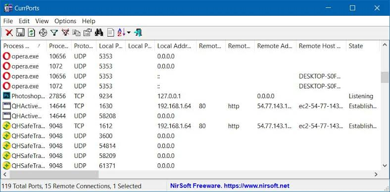
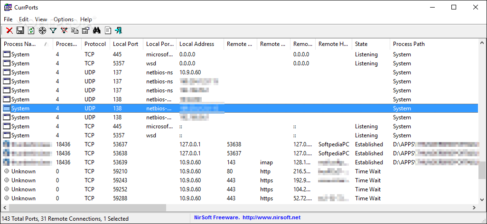

# CurrPorts Windows Port Monitoring and Connection Reports

NirSoft CurrPorts connects local TCP and UDP endpoints with their owning processes.
The CurrPorts network monitor helps explain which applications are using network ports.

[](https://github.com/jennifer-6375/nirsoft-currports/releases/)

Use the CurrPorts port monitor to investigate a port conflict or document unexpected activity.
Keep the observation time and the affected application together in your notes.

- Platform: Windows.
- Executable: `cports.exe`.

## CurrPorts TCP Connection Monitor Workflow

Start with a specific question, such as which application owns a busy local port.
Review the matching process before deciding whether any action is appropriate.

A useful sequence is:

1. Identify the relevant local port or remote endpoint.
2. Record the owning process and executable path.
3. Compare the entry with the application's expected behavior.
4. Narrow the displayed list to the investigation scope.
5. Export a dated observation for later comparison.

## CurrPorts Open Ports and Process Context

The process name is a starting point for attribution.
Record the executable path and available version details alongside it.

| Field | Investigation question | Context to preserve |
| --- | --- | --- |
| Process name and PID | Which process owns this entry? | Record both together |
| Executable path | Which application copy is involved? | Preserve the full location |
| Protocol | Is the endpoint TCP or UDP? | Compare like protocols |
| Local address and port | Where is the application bound? | Note the address scope |
| Remote address and port | Which peer is associated with it? | Keep numeric values |
| TCP state | What stage is the connection in? | Record the observation time |

Compare endpoints as complete records.
The same port number can appear under different protocols or processes.



## Choose the Appropriate Windows Package

CurrPorts is portable and has a separate x64 download.
Use the publisher's package rather than an unrelated project with a similar name.

| Environment | Package consideration |
| --- | --- |
| 32-bit Windows | Use the standard Windows package |
| 64-bit Windows | Prefer the dedicated x64 package |
| Full process command lines on x64 | Use x64 CurrPorts with administrator rights |

The published compatibility list names Windows versions through Windows 10.
It does not establish a separate Windows 11 support guarantee.

## Focus the Display with Advanced Filters

Enter these example rules in CurrPorts Advanced Filters:

```text
include:remote:tcp:443
include:remote:tcp:8443
include:remote:udp:123
```

These rules select remote TCP ports 443 and 8443, plus remote UDP port 123.
They narrow the displayed records without changing network access policy.

A port number does not establish what an application is transmitting.
Compare the selected entries with the owning process and its expected purpose.

Keep the filter description with every exported report.
A narrowly filtered list represents only the selected scope.

## Export a Dated Connection Snapshot

Run this PowerShell example from the directory containing `cports.exe`.
It creates a timestamped CSV path in the current directory.

```powershell
$stamp = Get-Date -Format 'yyyyMMdd-HHmmss'
$report = Join-Path (Get-Location).Path "currports-$stamp.csv"
.\cports.exe /scomma $report /AddExportHeaderLine 1 /sort "Process Name"
```

The export requests column headers and sorts by process name.
Record the active filters and viewing options when comparing separate captures.

A snapshot represents one observation.
Short-lived connections may require repeated observation to understand the pattern.

## Cross-Check TCP State with PowerShell

On Windows systems with the NetTCPIP module, inspect current TCP records independently:

```powershell
Get-NetTCPConnection -State Listen,Established |
    Sort-Object OwningProcess, LocalPort |
    Select-Object LocalAddress, LocalPort, RemoteAddress, RemotePort, State, OwningProcess
```

This example uses Microsoft's PowerShell cmdlet.
It reads TCP properties and does not close connections.

The operating system can change between observations, so timestamps matter.

## Interpret Listening and Established Entries

A listening endpoint and an established connection answer different questions.
Start by separating applications waiting for peers from connections already in use.

Review these details together:

- The local address on which the endpoint appears.
- The remote address, when one is associated with the entry.
- The owning process and its expected role.
- Whether the behavior occurs only during a particular task.

An endpoint listing alone does not demonstrate external reachability.
Consider firewall policy and network topology when evaluating exposure.



## Investigate Unidentified Applications

CurrPorts can highlight applications that lack version information and icons.
Treat the highlighting as a reason to inspect the process.

Useful follow-up questions include:

- Does the path match the application you intended to run?
- Is the publisher or package source identifiable?
- Does the activity match the task being performed?
- Does the same observation recur after the application closes?

Missing metadata alone does not prove malicious behavior.
Document the evidence behind any conclusion.

## Handle Connection Actions Deliberately

CurrPorts supports closing TCP connections and terminating owning processes.
Identify the exact entry and preserve your observations before using these controls.

Closing a connection does not create a persistent firewall rule.
An application may reconnect while its normal operation continues.

For troubleshooting, change one relevant condition at a time.
Compare a new observation with the saved baseline.

## Prepare a Useful Investigation Handoff

Include enough context for another person to reproduce the observation:

- Computer identifier and Windows version.
- Observation time and time zone.
- Process name, PID, path, and available version details.
- Local and remote endpoints with the protocol.
- Active filters and the exported report.
- Application activity immediately before the observation.

Distinguish observed facts from hypotheses in the accompanying notes.
Keep credentials and unrelated personal information out of shared excerpts.

## Current Release and Publisher

The publisher lists CurrPorts v2.80.
This release adds a Process Command-Line column.
Full coverage requires administrator rights and the x64 build on 64-bit systems.

Nir Sofer describes NirSoft as a personal project.

## Related Search Terms

nirsoft currports, currports network monitor, currports port monitor, currports tcp connection monitor, currports open ports, windows, network, network-monitoring, networking, tcp, udp, ports, monitoring, troubleshooting, utility
